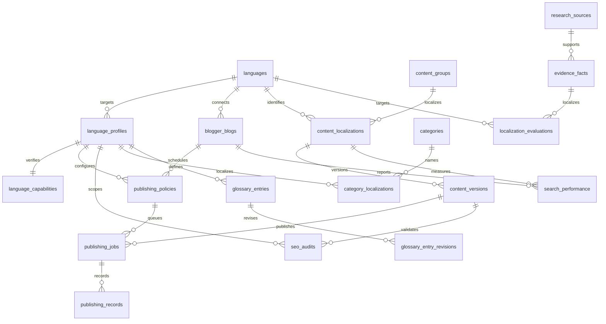

# 다국어 데이터 모델 (schema version 26)

언어 수는 제한하지 않는다. 초기 ko/en/zh-CN/ja는 시드이며, 코드의 조건 분기가 아니다.

| 테이블 | 관계 및 보존 규칙 |
|---|---|
| languages | BCP 47 code PK, 표시 이름, 활성 상태. 대소문자 중복 금지. 코드 변경 대신 새 언어 등록 및 기존 언어 비활성화 |
| language_profiles | language + target_country 별 검색 의도·생성·현지화·SEO 정책. 빈 국가는 공통 정책이며 자동 국가 추론 없음 |
| language_capabilities | profile별 생성·번역·품질 지원, 어댑터 ID, 검증 시각. 일반 API는 검증 상태를 수정하지 못함 |
| blogger_blogs | 언어당 N개 블로그. URL과 언어 정체성은 불변. 실제 Google Blog ID는 nullable, 연결·테스트 발행 검증 시각은 별도 |
| content_groups | 언어 수와 무관한 원본 그룹 |
| content_localizations | group + language + target_country 유일. 언어가 같아도 국가별 별도 현지화 가능 |
| content_versions | localization + version 유일. UUID와 본문·제목 불변. source_version_id는 같은 그룹의 출처 버전만 참조 |
| categories / category_localizations | 공통 식별자 및 국가별 프로필의 카테고리 명칭 |
| localization_categories | 현지화 콘텐츠와 공통 카테고리의 N:M 연결 |
| glossary_entries / glossary_entry_revisions | 프로필·원어·원문/대상 언어·공식 번역 근거·승인 상태. 기존 용어는 미승인으로 backfill하며 변경 스냅샷은 append-only |
| evidence_facts | 승인된 최신 출처에서 추출한 정확한 원문 구간. source language, entity IDs, 숫자·날짜, citation IDs와 추출기 버전을 저장. UPDATE/DELETE 불가 |
| localization_evaluations | 사실 단위 언어별 결과·검사·시간·호출 수. 의미·자연스러움은 사람 검토이며 publish_ready는 DB CHECK로 false |
| publishing_policies | blog + profile별 cron·IANA 시간대·활성 상태. 블로그와 프로필 언어 일치 FK. 자동 발행 허용은 Phase 1 DB CHECK로 false 고정 |
| publishing_jobs | 정책·블로그·정확한 콘텐츠 버전·예약 시각·멱등성 키. 콘텐츠 언어·대상 국가는 정책과 일치해야 함. 현재 발행 Worker가 실행하지 않음 |
| publishing_records | 작업·블로그·버전 FK, 원격 게시글 ID, 발행 시각. append-only. blog+version 및 blog+remote_post 유일 |
| seo_audits | 정확한 버전·국가별 프로필·검증기·검사 결과 JSON·통과 여부. 언어·국가 일치 트리거. append-only |
| search_performance | 블로그·현지화·검색 국가·기간·클릭·노출. 언어 일치 검증. 수집기는 아직 없음 |
| audit_events | 기존 실행 UUID 및 append-only 이벤트 보존. 추가 language_code/blog_id FK는 nullable이라 기존 이벤트 호환 |

### Phase 5-C publication approval

`publication_approval_events` stores user approval and revocation as append-only events keyed to `evaluation_id`, `content_version_id`, the exact latest `editorial_version_id` (nullable only for the unchanged source version), and the approved body SHA-256. An approval requires an existing positive editorial review for that exact version and a passing machine gate. A new revision changes the target version/hash and therefore requires a new decision. Revocation references the active approval event. This record expresses user intent only: it creates no publishing job, does not update `publish_ready`, and grants no Blogger API permission. Migration 033 adds the table and runtime INSERT/SELECT grants.

`blogger_blogs.blog_id`만 Google의 원격 Blog ID이고, 다른 테이블의 `blog_id` FK는 내부 UUID인 `blogger_blogs.id`를 참조한다. 내부 UUID 생성은 원격 Google ID 확인과 무관하다.

BCP 47은 API의 langcodes/등록 데이터 기반으로 검증·정규화한다. 예: zh-tw → zh-TW, pt-br → pt-BR. 별칭은 표준 태그로 정규화되어 기존 코드와 충돌할 수 있다. 밑줄 입력은 거절한다. DB에는 기본 태그 형태와 대소문자 중복 제약을 추가했다. langcodes는 언어·문자·지역·variant를 검증하지만 모든 확장 서브태그의 의미까지 검증하지 않는다. 확장 태그의 엄격한 의미 검증이 필요한 어댑터는 별도 검증해야 한다. 국가 값은 대문자 2자리/숫자 3자리 형태이며 실제 시장 지원 여부는 어댑터 검증 대상이다.

## 호환 마이그레이션
001은 수정하지 않았다. 002는 언어 고정 CHECK를 제거하고 기존 버전을 공통 국가의 현지화로 연결한다. 메타데이터 localization_id만 채우기 위해 트랜잭션 안에서 content_immutable 트리거를 잠시 비활성화하고 즉시 복원한다. 테이블 잠금과 트랜잭션으로 외부의 중간 상태 접근을 막는다. 기존 UUID, 제목, 본문, 출처, 시각, 감사 payload는 유지한다. 기존 group_id/language 입력도 BEFORE INSERT 브리지로 계속 지원한다. 새 쓰기는 localization_id를 지정하고 FK 일치를 보장해야 한다.

003은 역사적 정체성 변경 차단, 출판·SEO·성과의 현지화 참조 검증, 시드 언어 감사 이벤트를 추가한다. 004는 공통 카테고리 등록 권한·감사와 조회 인덱스를 추가한다. migrate.py는 프로젝트 DB만 허용하고 advisory lock과 한 트랜잭션에서 미적용 순서를 실행한다. 재실행은 적용 이력을 건너뛴다. 적용한 SQL을 수정하지 말고 후속 파일을 추가한다.

마이그레이션 통합 테스트는 임시 스키마를 롤백하여 001 → 004 전체 경로의 기존 값 보존을 확인한다. 설정 API 테스트도 외부 트랜잭션을 롤백하므로 가짜 운영 블로그를 영구 등록하지 않는다. 실제 설정의 비활성화는 삭제 없이 이력을 보존한다.

## 범위 제한
콘텐츠 편집·비교 UI, SEO 검사 실행기, 성과 수집기, 발행 outbox와 원격 재조정은 후속 단계다. seo_audits.checks는 향후 언어별 키워드·제목·본문·메타데이터·출처·중복·저작권·정책 검증 결과를 버전별로 기록하도록 설계했다. 현재 모델이나 검증기 지원을 추정하여 통과 결과를 만들지 않는다. 예약·발행 기록 테이블은 기반이며 실제 운영 게시 요청을 만들지 않았다.

## Phase 2 추가 (schema 6)
005는 google_connections(암호화 토큰·최소 scope·만료·안전한 오류 상태), google_oauth_states(일회용 state/바인딩 해시·암호화 verifier), blogger_api_calls(append-only 요청·시도·오류 이력), language_execution_limits(동적 언어별 읽기 허용·분당 한도·페이지 크기), blogger_write_operations(Mock 멱등성 원장)을 추가한다. blogger_blogs는 OAuth 연결 FK, 마지막 검사 시각, 안전한 오류 분류를 추가한다. 새 언어는 DB 트리거로 기본 실행 제한을 받는다.

006은 기존 localization_categories에 로컬 버전 관리용 INSERT 권한만 추가한다. 기존 001–004 SQL은 변경하지 않았다. publishing_enabled/auto_publish_allowed의 DB false 제약과 불변 콘텐츠·감사·발행 기록을 유지한다. 런타임은 여전히 woori_app이며 관리자와 마이그레이션 소유자 설정은 API가 읽지 않는다. OAuth 계정 정보 조회는 암호문조차 반환하지 않는다.

## Schema version 14: durable generation stages
Migration `014_generation_stages.sql` adds `generation_stage_runs`, keyed by a UUID and linked to a run/profile target. The row records worker attempt, stage sequence and retry, stage name, model and prompt version, JSON input/output snapshots, evidence source IDs, validation JSON, error category, and timing. The lifecycle permits a single update from `running` to a terminal status; identity fields cannot change and deletion/truncation is denied. A recovery process records interrupted in-flight stages as failed with `worker_interrupted`. Audit events are appended for stage start, terminal result, and recovery. Stage snapshots are internal research data and must never contain credentials.

Migration 014 is additive; it preserves existing versions, audit events, publication records, and source evidence. Terminal stage records remain queryable for comparison and incident review.

## Phase 3.9-S quota and Worker model (schema version 24)

`generation_settings` stores independent `daily_limit` and `evaluation_daily_limit` values per profile. Quota is consumed when a generation target is created; terminal failed/cancelled targets remain counted, while retries reuse the same target. The quota window is explicitly 00:00?00:00 Asia/Seoul. `pipeline_controls.evaluation_isolated` defaults to false. Evaluation work is accepted only when the evaluation runtime proves it is connected to a physically distinct PostgreSQL database from the configured operations database; its worker filters to evaluation jobs, and both modes retain the same global pause/resource/concurrency gates. `worker_heartbeats` has separate `research_worker` and `evaluation_worker` rows. Migration 024 records its schema change as an append-only audit event and does not reset existing quotas or content.

## Phase 4-A publication requests (schema version 25)

`publishing_jobs` is extended with a domain `publication_state`, structured block reasons, and database-enforced `adapter_type='fake'` / `simulation_only=true`. A request is evaluated against the localized version, active language, mapped blog, latest immutable article quality result, and publication policy. Missing human review, false publish readiness, and the global disabled-write policy keep it blocked. State changes are recorded in immutable `publication_state_events`.

`publication_attempts` records only offline fake-adapter scenarios and uses `fake-post-*` identifiers; it is append-only and separate from `publishing_records`, which remains reserved for actual remote posts. No schema or UI path can set `publish_ready=true` or enable Blogger writes. Migration 025 adds these controls without changing existing content, posts, or audit events.

## Phase 4-B schedules and worker (schema version 26)

`publishing_jobs.scheduled_at` is stored as `timestamptz` (UTC); `schedule_timezone` retains the display zone. API validation rejects naive, past, and offset-mismatched timestamps. `publication_schedule_events` is append-only and uses an idempotency key. `publication_worker` claims only due rows constrained to `adapter_type='fake'` and `simulation_only=true`; it never updates a domain state to `published` or writes `publishing_records`. Retryable fake timeout/server scenarios are bounded by `max_retries`; auth errors and uncertain outcomes stop for review. Lease recovery requeues within the same bound.

`publication_attempts` distinguishes interactive simulations from Worker attempts. Actual Blogger sync uses the existing read-only Blogger client, records a sync audit, and reports remote/internal matches without changing internal publication state. Fake post identifiers are kept outside the real `publishing_records` table.
