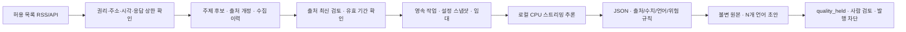

# Phase 3.5 실제 추론·자료 수집

추론 서버도 프로젝트 전용 키 인증을 적용하고 루프백에서만 수신한다. 이전 Phase 3 요청의 멱등성 fingerprint도 호환해 기존 작업을 중복 생성하지 않는다.

기존 콘텐츠 그룹·언어/국가 프로필·불변 버전·감사·Worker·Scheduler를 확장한다. Blogger 쓰기나 유료 AI 모듈과 연결하지 않는다.

## 엔진과 모델

공식 llama.cpp b11889 Windows CPU x64(MIT)를 프로젝트 `.local/llama-b11889`에 설치한다. 공식 Qwen3 0.6B/1.7B Q8_0(Apache 2.0) 파일을 `.local`에 저장한다. 릴리스와 모델의 SHA256·revision을 확인하며 다른 PATH/서비스/프로젝트를 바꾸지 않는다. 20GiB 미만 여유에서는 설치 스크립트가 다운로드를 거부한다. 실행 중에는 최소 가용 RAM 6GiB와 기존 CPU/RAM 수용 정책을 적용한다.

실제 엔진은 `127.0.0.1:11435`의 고정 `/v1/chat/completions`를 사용한다. 이는 로컬 llama.cpp의 호환 프로토콜이며 OpenAI API 호출이 아니다. 기존 Ollama 어댑터와 Mock 인터페이스를 유지한다. 모델 identity/프로세스 경로를 확인하고 임의 외부 endpoint나 유료 fallback을 허용하지 않는다. 모델 다운로드는 별도 setup 스크립트에서만 수행한다.

CPU 4 threads, context 8192, GPU layers 0, parallel slot 1, thinking=false로 실측했다. CPU/RAM은 프로세스 표본이며 GPU 이용률은 취득하지 못해 NULL이다. GPU layers=0이라는 설정을 실측 GPU 이용률 0%로 표현하지 않는다. 모델별 프롬프트/동일 자료 hash와 실패를 보존한다.

Provider는 SSE 조각을 받아 JSON schema와 출처 ID enum으로 검증한다. 타임아웃·최대 응답 길이·취소를 검사한다. 작업 중지 시 스트림을 닫으며 다른 프로세스를 종료하지 않는다. 자료/작업 상태·attempt·300초 임대를 저장 전 다시 확인한다. 불완전 JSON/장애는 정상 콘텐츠 버전으로 저장하지 않는다. 오래된 임대나 변경된 근거는 기존 복구·차단 정책을 따른다.

## DB 추가 모델

마이그레이션 011–013은 적용 후 수정하지 않는다.

- `generation_settings.engine`: 기존 ollama 또는 llamacpp, timeout 상한 180초.
- `collection_sources/topics`: 허용 소스·이용 조건·주기·카테고리별 질의. 새 카테고리 연결은 데이터로 관리한다.
- `collection_jobs`: 기존 job_runs의 collection 종류에 연결한 영속 수집 작업.
- `collection_items`: 외부 identity+payload hash와 키워드/자료 참조, append-only.
- `research_sources.revision`: 기존 근거를 덮어쓰지 않는 URL별 개정. 생성은 최신 개정만 사용한다.
- `model_measurements`: 모델 revision·동일 자료 hash·언어별 실제 샘플·검사·자원 측정·실패, append-only.
- `generation_jobs.evaluation_only`: 언어 품질 승인 없이 수행하는 명시적 평가 작업. 결과는 항상 quality_held다.

수집의 외부 ID와 payload hash를 유일하게 관리한다. 같은 자료 재시도는 새 키워드/출처를 중복 저장하지 않는다. 수정 자료는 새 출처 revision과 검토를 추가한다. 생성 도중 근거가 바뀌면 evidence_changed로 차단한다. 기존 콘텐츠·발행·감사 기록은 보존한다.

## 검증의 의미

규칙 검사는 출처 ID/허위 URL/새 수치/정보 기한/권리 기록/언어 문자/노골적 고위험 표현과 기존 구조·반복·유사도를 점검한다. 숫자와 문자를 확인해도 의미적 사실 일치나 자연스러움이 입증되지는 않는다. 제목/검색 의도 검사는 휴리스틱이며 다국어 제목의 정상 의역을 보류할 수 있다. 모델 기반 자기점수로 승인하지 않는다. 실측 샘플의 별도 에이전트 관찰도 최종 사람 검토를 대신하지 않는다.

특히 실제 테스트에서 0.6B의 언어 불이행·JSON 실패와 1.7B의 고유명사 오역·없는 배경/전망·반복을 확인했다. 두 모델 모두 일반 자동 처리 품질 승인을 주지 않는다. 명시적 평가 초안만 보존하며 모든 seo_audits.passed와 publish_ready는 false다. 현재 구현은 무인 발행 가능한 생성 품질을 달성한 상태가 아니다.

### Phase 3.6: evidence-led generation and model comparison

The Worker now splits reviewed source text into a deterministic source-linked fact ledger (`verified_facts`); this is a traceability transformation, not a second truth check. The content plan remains a separately stored outline. The local prompt makes the generation/localization stages explicit and requires `[source:ID]` per substantive factual paragraph. The post-generation rule gate separately reports missing/unknown citations, source numbers, conservative Latin proper-name preservation, unsupported Latin names, repeated paragraphs, metadata-language mismatch and malformed source URL shape. URL network existence is explicitly `not_rechecked_by_quality_gate`: a general HEAD/GET against user-entered URLs would violate the exact outbound allowlist and could create SSRF/cost exposure. The allowlisted collector's successful fetch remains the only network evidence; a human/model review is still required to establish meaning.

### Phase 5 trend RSS extension

`trends.py` is a separate, on-demand signal collector. The Google Trends RSS endpoint is fixed to six configured geographies (KR, US, JP, TW, HK, SG), gated through the shared outbound client, capped at 1 request/minute, 12 append-only reserved attempts per rolling hour, 1 MiB, and 20 seconds. Attempts, runs, observations, response hashes, and metadata-only audit events are append-only under migrations 035–036. The feed is not treated as an article source: if a source does not emit an explicit rank or related term, those fields are stored as null/empty rather than inferred. RSS item order is not a rank. Manual collection is exposed on `/research`; scheduled collection remains off. Ranking/trend signal is not a substitute for verified, topic-relevant primary sources. Naver DataLab, the limited-access Google Trends API alpha, Daum/Nate collection, Gemini, article generation, and Blogger writes are not enabled by this extension.

The dashboard offers side-by-side selection of immutable measurement rows and displays actual samples, rule results, status and collected metrics. Model measurements do not certify quality, and all generated versions remain internal. The installer pins the official Qwen3-4B/8B Q4_K_M revision and SHA-256 in the local manifest; startup admission checks available RAM against file size plus 3 GiB. This PC enumerated an AMD RX 570 under Vulkan 1.3.260 and completed Qwen3-4B inference with the separate project-local llama.cpp b11889 Vulkan build at 20 GPU layers. Per-process GPU Engine counter values are reported as maximum engine utilization, not overall GPU utilization. The Phase 3.6 evaluation record contains repeatable CPU/Vulkan comparisons. None of the measured models passed the deterministic quality gate; all samples remain `quality_held` and semantic fact support/naturalness still require human review.
